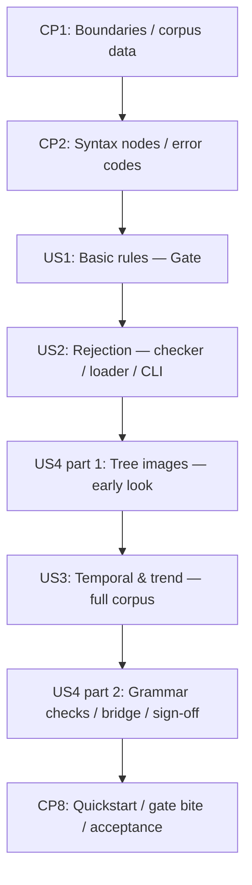

# Tasks: M1 不變量 DSL 與 Parser Tree

> Markers: [ ] not started · [-] implemented, awaiting review · [X] reviewed + verified

**Input**: `specs/002-rule-dsl-parser/` 的 spec.md、rule-corpus.md、plan.md、research.md、data-model.md、contracts/ 與 quickstart.md。
**Prerequisites**: Specify／clarify／plan 已完成；所有路徑相對 repository root。
**Tests**: 憲章「Parser 與 Evaluator 核心 MUST 測試先行；測試 MUST 先失敗再實作」，且 spec SC-001～SC-009 都要求自動化或 rendered 驗證，因此包含測試任務。
測試先寫並記錄對應行為的失敗，再完成實作；缺 module 的 import error 不算行為 RED。
**Organization**: 依 US1（P1）→ US2（P1）→ US3（P2）→ US4（P3）分組。M1 完成條件是頂階「全語料」（spec SC-004），四個 story 都要做完。

## Format & Execution Rules

- 任務格式為 `- [ ] Tnnn [P?] [USn?] 描述與明確檔案路徑`；所有任務初始為 `[ ]`。
- `[P]` 只表示列出的 prerequisites 完成後，該組不同檔案的任務可並行；不表示可跳過 checkpoint。未標示者按編號順序執行。
- 實作前依 `~/.agents/skills/delegated-tdd/SKILL.md` 對剩餘 scope 執行 delegation gate 並宣告 rung；本輪生成任務不等於開始 implementation run。
- 執行進度採 `[ ]` → `[-]`（已實作、待 review）→ `[X]`（review 通過且主代理複驗）；文件與純資料任務的驗證方式依 delegation gate 結果記錄，不虛構 RED。
- **預期語法樹不由 parser 產生**（plan「測試的獨立性」）：先在 `tests/contract/rule_shapes.py` 手寫每條規則的巢狀 tuple 結構，parser 輸出結構與它一致後，
  才產生 `tests/fixtures/rule_trees/<短名>.json` 並 commit；之後的回歸比對那些 bytes。
- 寫檔測試一律用 pytest `tmp_path`；CLI subprocess 也一樣。故意改壞的 source 只放在隔離 worktree／scratch copy，不在主工作區做。
  負向案例的 pytest parameter ID 標明錯誤碼或 FR／SC，讓 gate failure 指出被破壞的要求。
- M1 只解析與檢查：不評估規則、不讀遙測流、不維護視窗、不綁定門檻值、不修改 Simulator／情境、不做效能宣稱（spec Scope Boundaries）。
- 演算法模組（lexer、parser、checker、units、tree_view）MUST 在 module docstring 引用 `docs/algorithms/002-rule-dsl-parsing.md` 的對應章節；
  完整的出處與白話說明只放在該文件（T041），不在程式碼複製多份會漂移的說明。

## Phase 1: Setup — 邊界與語料資料

**Purpose**: 解除 `dsl` 的空套件限制、補上它自己的依賴邊界，並把 17 條語料寫成規則集資料。

- [X] T001 修改 `tests/architecture/test_dependency_boundaries.py`：`RESERVED_PACKAGES` 移除 `"dsl"`；`FORBIDDEN_DEPENDENCIES` 新增 `"dsl": ("assertion_engine.evaluator", "assertion_engine.fuzzer", "assertion_engine.simulator", "assertion_engine.playback")`；
  照既有的參數化寫法加入 `dsl/` 引用 evaluator 與 playback 的違規案例，確認既有「fuzzer 不得引用 dsl」案例仍在且通過（FR-016）。
- [X] T002 在 `tests/contract/test_rule_corpus.py` 撰寫語料對照測試（只用 `tomllib`，不 import `assertion_engine.dsl`）：`rules/corpus.toml` 的 rule 短名集合等於
  `specs/002-rule-dsl-parser/rule-corpus.md` 的 `### \`短名\`` 標題集合；類別數為 threshold 4、logic 3、temporal 6、trend 4；有 1 個 derived、27 個 parameters。
  先在檔案不存在時跑一次記錄 RED。
- [X] T003 依 `specs/002-rule-dsl-parser/research.md`「17 條語料的寫法」與 `contracts/ruleset.md` 建立 `rules/corpus.toml`：`schema_version = "1.0.0"`、27 個 `[parameters.*]` 的單位、
  `[derived.return_time_s]`、17 條 `[rules.*]` 的 category 與 expression（字面照 research，不改寫）；讓 T002 通過。（depends on T002）

**Checkpoint CP1**: 架構邊界允許 `dsl` 有內容但禁止它引用其他元件；語料資料與白話語料的短名一致。尚未宣稱任何解析行為。

## Phase 2: Foundational — 語法樹與錯誤詞彙

**Purpose**: 所有 story 共用的不可變節點、正規序列化與封閉錯誤碼清單；不含 lexer、parser 或 checker 行為。

- [X] T004 [P] 在 `tests/unit/dsl/test_syntax.py` 撰寫：15 種節點可建構且不可變、以值比較相等；`to_document` 對每種節點輸出 `contracts/syntax-tree.md` 的欄位；
  `contracts/syntax-tree.md` 範例樹經 `canonical_bytes` 等於該檔的字面 bytes（以字面值判定，不用受測程式產生預期值）；數字常值 `"0.0000005"` 序列化後不被量化。
- [X] T005 [P] 在 `tests/unit/dsl/test_errors.py` 撰寫：錯誤碼集合等於 `data-model.md` 的 22 個字面碼；`Diagnostic` 帶 code、message 與 expression／file 兩種 location；
  `RuleSetError` 只帶一個 diagnostic。
- [X] T006 在 `src/assertion_engine/dsl/syntax.py` 實作 `Span`、15 種 frozen 節點與 `to_document()`，序列化交給 `assertion_engine.artifacts.canonical_bytes`；讓 T004 通過。（depends on T004）
- [X] T007 在 `src/assertion_engine/dsl/errors.py` 實作 `CODES`、`ExpressionLocation`、`FileLocation`、`Diagnostic`、`RuleSetError`；讓 T005 通過。（depends on T005）

**Checkpoint CP2**: 節點與錯誤型別固定，canonical bytes 與 contract 範例逐位元組一致；story 可以開始。

## Phase 3: User Story 1 — 把基本規則解析成語法樹（P1）🎯 Gate「基本規則」

**Goal**: 7 條門檻比較與邏輯組合規則、5 個衍生量定義解析成與預期一致的語法樹（spec SC-001）。

**Independent Test**: 7 條規則的語法樹結構等於手寫結構、canonical bytes 等於 golden，連續解析 3 次 byte-identical。

### Tests for User Story 1

- [X] T008 [P] [US1] 在 `tests/unit/dsl/test_lexer.py` 撰寫：整數與小數（`0.5`）、名稱、10 個關鍵字（`contracts/grammar.ebnf`「Lexical notes」）、`or`／`not` 保留字、`+ - * / ( ) , . < <= > >= == !=` 的 token kind 與 span；
  多行運算式的行與欄；`n`／`e`／`d` 是一般名稱；空白不產生 token。
- [X] T009 [P] [US1] 建立 `tests/contract/rule_shapes.py`：以巢狀 tuple 手寫 7 條基本規則（`battery-floor`、`altitude-ceiling`、`horizontal-speed-limit`、`return-reserve`、
  `geofence-cylinder`、`low-battery-stay-close`、`descent-speed-near-ground`）與 5 個衍生量定義（`contracts/ruleset.md` 的 4 個內建定義字串與 `return_time_s`）的預期結構，
  記法寫在 module docstring，結構由 `contracts/grammar.ebnf` 推導、不經 parser；在 `tests/contract/test_rule_trees.py` 撰寫 Gate 階測試：
  從 `rules/corpus.toml`（`tomllib`）取運算式，結構比對 `rule_shapes.py`；`tests/fixtures/rule_trees/*.json` 的檔名集合必須等於目前已到達階的規則集合
  （缺檔或多檔都紅燈，不以「檔案存在才比對」略過），並逐檔比對 bytes；每條解析 3 次 byte-identical（SC-001、SC-008）。
- [X] T010 [P] [US1] 在 `tests/unit/dsl/test_parser.py` 撰寫：`a - b - c` 左結合、`a implies b implies c` 右結合、`a and b and c` 左結合、`a + b * c`、`-x.d` 的
  Negate 包 Component、`-a * b` 的 Negate 只包 `a`、`a < b and c < d implies e < f`（spec US1 情境 2：`and` 比 `implies` 先結合）、
  `if c then a else b implies d` 的 else 吞下 `implies`、加括號改變樹、比較右側的條件值需要括號——8 個層級的每一組相鄰對至少一例（供 T039 咬合檢查）；Compare／Arithmetic／Negate／Component／Call 的 span
  逐一手寫驗證，括號不計入 span；coverage collector 對 `(a + b) * c` 記下 grouping、additive、multiplicative、name。

### Implementation for User Story 1

- [X] T011 [US1] 在 `src/assertion_engine/dsl/lexer.py` 實作 ASCII 掃描器與帶 span 的 token；讓 T008 通過。（depends on T006、T007、T008）
- [X] T012 [US1] 在 `src/assertion_engine/dsl/parser.py` 實作 Pratt parser：`data-model.md` 的 8 列 `BINDING_POWERS` 表（可由參數注入，供 T039 使用）、
  非時間構造的 prefix／infix handler、coverage collector；讓 T009（結構部分）與 T010 通過。（depends on T011、T009、T010）
- [X] T013 [US1] T009 的結構比對全部通過後，以 parser＋`canonical_bytes` 產生 7 條基本規則的 `tests/fixtures/rule_trees/<短名>.json`，逐檔對照 `rule_shapes.py` 檢查後 commit；
  確認 T009 的 golden 檔名集合等於 7 條、bytes 比對與 3 次決定性都通過。（depends on T012）
- [X] T014 [US1] 建立 `specs/002-rule-dsl-parser/validation.md`，記錄 Gate 階（SC-001）的 runner 摘要、受測 commit、7 條規則清單與 RED→GREEN 紀錄。（depends on T013）

**Checkpoint CP3**: 爬到 Gate「基本規則」；GAR-18 字面驗收「可解析基本規則（比較、邏輯運算）為語法樹」成立。

## Phase 4: User Story 2 — 無效規則被拒，並指出哪裡錯（P1）

**Goal**: 名稱、參數個數、型別與量綱檢查，以及整條 fail-closed 載入流程；21 個錯誤碼（`nonpositive_duration` 在 US3）各至少 2 例被拒且位置正確。

**Independent Test**: 無效規則集的每一例都被拒、不產生語法樹或規則集，回報的 code 與位置等於 fixture 記錄的值。

### Tests for User Story 2

- [X] T015 [P] [US2] 在 `tests/unit/dsl/test_units.py` 撰寫：6 個單位字串對應 `contracts/ruleset.md` 的指數三元組；乘除時指數相加減；未知單位被拒；推導出的量綱可格式化成標籤（如 `%/s`）。
- [X] T016 [P] [US2] 在 `tests/unit/dsl/test_checker.py` 撰寫：`contracts/ruleset.md`「Type and dimension rules」每一條至少一正一負；常值 `0` 取得夥伴的量綱、其他常值無因次；
  4 個內建衍生量的定義字串與單位等於 contract 表；`return_time_s` 推導為 `s`；`derived_unit_mismatch`、`derived_cycle`、`not_boolean_rule`、`unknown_name`、
  `arity_mismatch`（`norm(a, b)`）、`type_mismatch` 的 location 指向對應節點的 span；每個 `Name` 節點解析成 field、derived 或 parameter。
- [X] T017 [P] [US2] 在 `tests/unit/dsl/test_ruleset.py` 撰寫：只含非時間規則的有效小規則集可載入；TOML 語法錯誤回報 file location（`lineno`／`colno`）；
  未知 key、缺 key、錯誤 `schema_version`、零條 rule、未知 category、不合法名稱 → `invalid_ruleset`；`name_conflict`、`unknown_unit`；
  兩個錯誤同時存在時回報 `data-model.md` 載入流程中較早的那一個；失敗時不回傳部分規則集。
- [X] T018 [US2] 建立 `tests/fixtures/invalid_rules.toml`（`data-model.md`「Regression suite files」格式）：`nonpositive_duration` 以外 21 個錯誤碼各至少 2 例，
  每例記錄 code 與 `line`／`column` 或 `file_line`／`file_column`；在 `tests/contract/test_invalid_rules.py` 撰寫參數化測試（parameter ID 為錯誤碼），
  `expression` 例嵌入最小有效規則集後載入（SC-005）。
- [X] T019 [P] [US2] 在 `tests/integration/test_rules_cli.py` 撰寫：`check` 對只含基本規則的 `tmp_path` 規則集輸出 `ok: …`、exit 0；無效規則集在 stderr 輸出
  `contracts/cli.md` 的診斷格式（含 caret 行）、exit 1、stdout 為空；缺參數或無法讀取的檔案 exit 2；`dump --rule battery-floor` 對 `rules/corpus.toml` 以外的
  基本規則集輸出等於 golden 的 bytes；未知 rule exit 2。

### Implementation for User Story 2

- [X] T020 [P] [US2] 在 `src/assertion_engine/dsl/units.py` 實作 `Dimension` 與單位表；讓 T015 通過。（depends on T015）
- [X] T021 [US2] 在 `src/assertion_engine/dsl/vocabulary.py` 實作 5 個欄位、`norm`／`hnorm`、4 個內建衍生量（DSL 定義字串與單位）。（depends on T020）
- [X] T022 [US2] 在 `src/assertion_engine/dsl/checker.py` 實作名稱解析、參數個數、型別、量綱推導、常值 `0` 規則、衍生量依賴圖（循環與宣告單位）；
  location 取自節點 span；讓 T016 通過。（depends on T021、T012、T016）
- [X] T023 [US2] 在 `src/assertion_engine/dsl/lexer.py` 與 `parser.py` 補齊語法錯誤碼：`invalid_character`、`invalid_number`、`empty_expression`、`unexpected_token`、
  `unexpected_end`、`unclosed_parenthesis`、`trailing_input`、`chained_comparison`、`reserved_word`、`invalid_axis`，以及 `data-model.md`「Parse depth limit」的
  `nesting_too_deep`（深度 101 在 Python 遞迴上限之前就拒絕），位置照 `data-model.md`。（depends on T018）
- [X] T024 [US2] 在 `src/assertion_engine/dsl/ruleset.py` 實作 `data-model.md` 的 9 步 fail-closed 載入流程（依檔案順序、第一個錯誤就停）；
  在 `src/assertion_engine/dsl/__init__.py` 匯出 `load_ruleset`、`parse_expression`、`Diagnostic`、`RuleSetError`；讓 T017、T018 通過。（depends on T022、T023、T017）
- [X] T025 [US2] 在 `src/assertion_engine/dsl/cli.py` 實作 `check` 與 `dump` 及診斷格式；在 `pyproject.toml` 加入 `assertion-rules = "assertion_engine.dsl.cli:main"`，
  驗證 `uv sync --locked` 仍成功；讓 T019 通過。（depends on T024、T019）
- [X] T026 [US2] 在 `specs/002-rule-dsl-parser/validation.md` 記錄 21 個錯誤碼的案例數、runner 摘要與 RED→GREEN 紀錄。（depends on T025）

**Checkpoint CP4**: 錯的規則一律被拒並指出位置；基本規則集可經 CLI 檢查與輸出語法樹。

## Phase 5: User Story 4（第一部分）— 語法樹圖（P3，提前）

**Goal**: checker 完成後就能把規則畫成含型別與名稱類別的語法樹圖（FR-014），讓基本規則的樹早點看得到（learning-style：視覺化不推遲到最後）。

**Independent Test**: 手工小樹的版面與標籤正確；7 條基本規則的臨時規則集能經 `tree` 子命令畫出 PNG。

### Tests for User Story 4（第一部分）

- [X] T027 [P] [US4] 在 `tests/unit/dsl/test_tree_view.py` 撰寫：手工小樹的版面（葉節點依原文順序由左到右、父節點 x 為子節點平均、深度決定 y）；
  標籤含節點種類、原文片段、型別，`Name` 節點另含解析類別（field／derived／parameter）；以 Agg 寫入 `tmp_path` 的 PNG 非空；輸出已存在時拒絕且不改寫；繪製失敗時不留下部分檔案。

### Implementation for User Story 4（第一部分）

- [X] T028 [US4] 在 `src/assertion_engine/dsl/tree_view.py` 實作版面與 Matplotlib Agg 繪製（暫存檔＋rename、拒絕覆寫）；讓 T027 通過。（depends on T027、CP4）
- [X] T029 [US4] 在 `src/assertion_engine/dsl/cli.py` 加上 `tree` 子命令，在 `tests/integration/test_rules_cli.py` 加上 `tree` 的成功、輸出已存在（exit 2）與未知 rule 案例；
  此時時間保留字還不能解析、整份 `rules/corpus.toml` 載入不了，所以把 7 條基本規則與衍生量放進 `mktemp -d` 的臨時規則集畫圖，主代理先檢視，
  再讓 user 先看（早期回饋，不算 SC-009 簽核）。（depends on T028）

**Checkpoint CP5**: 語法樹圖可用；user 已看過基本規則的圖（早期回饋，不是 SC-009 簽核）。

## Phase 6: User Story 3 — 時序與趨勢規則解析成語法樹（P2）

**Goal**: 5 個時間保留字的語法、節點與型別；10 條時序與趨勢規則解析成預期語法樹，整份語料載入成功（spec SC-002、SC-003）。

**Independent Test**: 17 條規則的結構與 golden 全部比對成功，`assertion-rules check --ruleset rules/corpus.toml` 輸出 `ok: 17 rules, 1 derived, 27 parameters`。

### Tests for User Story 3

- [X] T030 [US3] 在 `tests/contract/rule_shapes.py` 補上 6 條時序與 4 條趨勢規則的手寫結構；在 `tests/contract/test_rule_trees.py` 加上「時序規則」（13 條）與「全語料」（17 條）
  兩階的測試（SC-002、SC-003）。（depends on CP5；與 T009 同檔，序列化）
- [X] T031 [P] [US3] 在 `tests/unit/dsl/test_parser.py` 補上：5 個時間保留字各自建出 `Previous`／`Ago`／`HeldFor`／`Within`／`Slope`，`HeldFor` 與 `Within` 是不同種類（US3 情境 2）；
  `prev(a, b)`、`slope(x)` 這類參數個數不合文法的寫法為 `unexpected_token`；時間節點的 span。
- [X] T032 [P] [US3] 在 `tests/unit/dsl/test_checker.py` 補上 `contracts/ruleset.md` 時間保留字的型別表：`ago`／`prev` 保留值的型別、`held_for`／`within` 要求 bool 與 `s`、
  `slope` 回傳 `D/s`；duration 不是 `s` 為 `dimension_mismatch`；常值 duration 為 `0` 或負數為 `nonpositive_duration`。
- [X] T033 [US3] 在 `tests/fixtures/invalid_rules.toml` 補上 `nonpositive_duration` 至少 2 例；在 `tests/contract/test_invalid_rules.py` 加上「`errors.CODES` 每一碼至少 2 例」的檢查（SC-005 完整）。（depends on T018）

### Implementation for User Story 3

- [X] T034 [US3] 在 `src/assertion_engine/dsl/parser.py` 實作 previous、ago、held_for、within、slope 五條產生式與 coverage 記錄；讓 T031 通過。（depends on T030、T031）
- [X] T035 [US3] 在 `src/assertion_engine/dsl/checker.py` 實作時間保留字的型別與 duration 檢查；讓 T032、T033 通過。（depends on T034、T032、T033）
- [X] T036 [US3] T030 的結構比對通過後，產生其餘 10 條規則的 golden 並逐檔對照 `rule_shapes.py` 後 commit，T009 的 golden 檔名集合改為必須等於全部 17 條；在 `tests/integration/test_rules_cli.py` 加上
  `check --ruleset rules/corpus.toml` 的 `ok: 17 rules, 1 derived, 27 parameters` 案例。（depends on T035）
- [X] T037 [US3] 在 `specs/002-rule-dsl-parser/validation.md` 記錄三階（7／13／17）的結果、22 個錯誤碼案例數與 runner 摘要；註明 SC-004（頂階）已達成。（depends on T036）

**Checkpoint CP6**: 爬到頂階「全語料」；M1 的解析範圍完成。

## Phase 7: User Story 4（第二部分）— 文法對應、白話橋接與簽核（P3）

**Goal**: 語法樹圖、文法對應的機械檢查、白話橋接文件；user 看實際圖片簽核（spec FR-002、FR-014、FR-015、SC-006、SC-007、SC-009）。

**Independent Test**: 17 張 PNG 都產得出來且 user 簽核；產生式覆蓋率與結合力表對應測試通過；故意改錯優先序時回歸測試失敗。

### Tests for User Story 4（第二部分）

- [X] T038 [P] [US4] 在 `tests/contract/test_grammar_coverage.py` 撰寫：從 `contracts/grammar.ebnf` 讀出帶 `used by:` 的 17 條產生式；對 4 個內建衍生量、`return_time_s` 與 17 條規則解析一輪，
  coverage collector 記下的集合必須恰好等於它（SC-006）；`parser.BINDING_POWERS` 的層級順序等於 grammar.ebnf 檔頭的 8 個層級（FR-002）；每個 `used by:` 的名稱都存在於語料或衍生量。
- [X] T039 [P] [US4] 在 `tests/contract/test_precedence_bite.py` 撰寫：對 8 個層級的全部 7 組相鄰對（含前綴的 conditional 與 unary），用注入的結合力表對調後解析語料與 T010 的案例，
  每一組至少一棵樹改變；
  把任一層級的結合力改錯時，至少一條 golden 或衍生量手寫結構（`rule_shapes.py` 的 `DERIVED_SHAPES`）的比對失敗，
  解析報錯也算失敗（SC-007）。語料規則沒有 `.`，postfix 只有衍生量用到，所以比對範圍含衍生量（user 2026-10-31 裁示）。

### Implementation for User Story 4（第二部分）

- [X] T040 [US4] 執行 T038、T039；若通過時沒有經過 RED，在隔離 scratch copy 分別刪掉 `specs/002-rule-dsl-parser/contracts/grammar.ebnf` 一條 `used by:`、
  在 `src/assertion_engine/dsl/parser.py` 加一個語料沒用到的構造、改錯一個結合力，確認未修改的測試各自失敗在對的斷言上；
  修正 `src/assertion_engine/dsl/parser.py` 或 `specs/002-rule-dsl-parser/contracts/grammar.ebnf` 直到兩個測試在主工作區通過。（depends on T038、T039、CP6）
- [ ] T041 [US4] 撰寫 `docs/algorithms/002-rule-dsl-parsing.md`：Pratt parser 與結合力的白話說明（Crafting Interpreters §17.6、Pratt 1973），每層一函式 recursive descent 的對照（同書 ch. 6）；
  5 個時間保留字與 MTL 有界運算子的對應（Koymans 1990）；量綱的定義（BIPM SI 手冊 §2.3.3）與 `%` 作為專案基本量的取捨；樹狀圖版面與 Reingold–Tilford 的差異；
  grammar.ebnf 每條產生式 ↔ parser handler 的對照表；在 T011、T012、T022、T020、T028 的 module docstring 引用對應章節（FR-015）。
- [ ] T042 [US4] 以 `assertion-rules tree` 把 17 條語料規則的圖畫到 `mktemp -d` 的目錄，主代理先逐張檢視，再交給 user 看實際圖片簽核：每條規則白話意圖的每個子句都指得到對應子樹（SC-009）；
  在 `specs/002-rule-dsl-parser/validation.md` 記錄簽核結果與發現的問題，不把圖片 commit 進 repo。（depends on T029、T041）

**Checkpoint CP7**: 語法樹看得見、文法對應有機械檢查、白話橋接完成。

## Phase 8: Polish & Cross-Cutting Concerns

- [ ] T043 [P] 更新 `README.md`：套件表中 `dsl` 不再是保留邊界，改述 M1 的規則 DSL；加入 `assertion-rules` 的用法與 `rules/corpus.toml` 說明；M0 段落不動。
- [ ] T044 [P] 照 `specs/002-rule-dsl-parser/quickstart.md` 逐字執行每段指令，在 `specs/002-rule-dsl-parser/validation.md` 記錄實際輸出與 exit code。
- [ ] T045 在兩個隔離 worktree 分別注入（a）一個優先序錯誤、（b）一條量綱規則錯誤（例如允許 `%` 與 `m` 比較），執行未修改的 gate，確認失敗來自 SC-007 與 SC-005 的對應測試，
  不是 Ruff、import 或環境錯誤；在 `specs/002-rule-dsl-parser/validation.md` 記錄受測 commit、mutation、runner 摘要與乾淨版本 PASS，不改主工作區 source。（depends on CP7）
- [ ] T046 在 `specs/002-rule-dsl-parser/validation.md` 彙整 FR-001～FR-016 與 SC-001～SC-009 的證據；重跑 `uv run ruff format --check .`、`uv run ruff check .`、`MPLBACKEND=Agg uv run pytest`，
  並確認 PR 的 `change-gate` check PASS；只有實作、review 與主代理複驗都完成才翻轉相應任務標記。（depends on T043–T045）
- [ ] T047 merge 後，把 spec Scope Boundaries 交給後續里程碑的事項寫進 Linear：GAR-19 收降落衝突、資料斷流偵測、第一筆無前一筆與時間差為 0；
  GAR-20 收視窗未填滿；各附本 spec 與 PR 連結，讀回 issue 確認寫入（spec-closeout「Refresh downstream items」）。記錄寫在 `specs/002-rule-dsl-parser/validation.md`。（depends on T046、merge）

**Checkpoint CP8**: 三階驗收、無效規則集、覆蓋率、咬合、視覺簽核與 quickstart 都有可重跑的證據；feature 進入 PR ready／closeout。

## Dependencies & Execution Order

- **Phase 1**: T001 與 T002 可並行；T003 在 T002 之後。
- **Phase 2**: (T004 + T005) → (T006 + T007)。
- **US1**: (T008 + T009 + T010) → T011 → T012 → T013 → T014。
- **US2**: (T015 + T016 + T017 + T019) 與 T018 → T020 → T021 → T022；T023 依賴 T018；T024 依賴 T022、T023；T025 → T026。
- **US4 第一部分**: T027 → T028 → T029。T028 需要 CP4 的 checker 型別；T029 擴充 T025 的 `cli.py`。
- **US3**: T030 與 (T031 + T032) → T033 → T034 → T035 → T036 → T037。T030 與 T009 同檔、T031 與 T010 同檔、T032 與 T016 同檔，
  T036 與 T029 都改 `test_rules_cli.py`，都在前一段完成後才動。
- **US4 第二部分**: (T038 + T039) → T040；T041 → T042。T038 的覆蓋率測試需要 CP6 的整份語料可解析。
- **Polish**: (T043 + T044) → T045 → T046 → T047（merge 後）。
- 各段之間是串行：US2 的 checker 需要 US1 的 parser；語法樹圖需要 checker 的型別；US3 擴充同一組檔案；US4 第二部分需要整份語料。
  並行只發生在同一段內的不同檔案。`parser.py`、`checker.py`、`cli.py`、`test_rules_cli.py`、`rule_shapes.py`、`validation.md` 的修改都須序列化。

## Parallel Examples

| Story / group | Prerequisites | 可同時執行的任務 | 不互相依賴的檔案 |
|---|---|---|---|
| Setup | — | T001、T002 | `tests/architecture/test_dependency_boundaries.py`、`tests/contract/test_rule_corpus.py` |
| Foundation tests | CP1 | T004、T005 | `tests/unit/dsl/test_syntax.py`、`tests/unit/dsl/test_errors.py` |
| US1 tests | CP2 | T008、T009、T010 | `test_lexer.py`、`rule_shapes.py`＋`test_rule_trees.py`、`test_parser.py` |
| US2 tests | CP3 | T015、T016、T017、T019 | `test_units.py`、`test_checker.py`、`test_ruleset.py`、`test_rules_cli.py` |
| US3 tests | CP5 | T031、T032 | `test_parser.py`、`test_checker.py` |
| US4 第二部分 tests | CP6 | T038、T039 | `test_grammar_coverage.py`、`test_precedence_bite.py` |
| Polish | CP7 | T043、T044 | `README.md`、`validation.md`（T044 獨佔） |

這些是可並行的工作範例；實際是否委派由 implementation run 的 delegation gate 決定。

## Requirement Coverage

| Requirements | 對應任務與主要驗證 |
|---|---|
| FR-001 | T002–T003、T009、T013、T030、T036：語料進版控、短名對照、golden 回歸 |
| FR-002 | T038、T040、T041：產生式 `used by:`、結合力表 ↔ 層級、handler 對照表 |
| FR-003 | T004、T006、T010、T012、T031：節點與 span |
| FR-004 | T008、T010、T012、T023：比較、`and`、`implies`、算術、負號、括號、呼叫；`or`／`not` 為保留字 |
| FR-005 | T016、T021、T022：欄位、分量、內建衍生量 |
| FR-006 | T009、T010、T012：條件值（`descent-speed-near-ground`） |
| FR-007–FR-008 | T030–T032、T034–T035：5 個時間保留字的語法與型別 |
| FR-009 | T003、T017、T024：具名門檻只宣告單位、不帶值 |
| FR-010 | T016、T018、T022：未宣告名稱與參數個數 |
| FR-011 | T017–T018、T023–T024、T033：fail-closed、第一個錯誤、位置 |
| FR-012 | T004、T006、T009、T013：正規序列化與 3 次決定性 |
| FR-013 | T015–T016、T020、T022、T032：單位宣告與量綱檢查 |
| FR-014 | T027、T028–T029、T042：語法樹 PNG |
| FR-015 | T041：出處、白話橋接、產生式對照 |
| FR-016 | T001：fuzzer 不得引用 dsl；dsl 不得引用其他元件 |
| SC-001 | T009、T012–T014：Gate「基本規則」7 條 |
| SC-002–SC-004 | T030、T034–T037：「時序規則」13 條、「全語料」17 條，M1 完成於頂階 |
| SC-005 | T018、T023–T024、T033、T045：22 碼 × 至少 2 例（含 `nesting_too_deep`），量綱 mutation 使 gate 失敗 |
| SC-006 | T038、T040：產生式覆蓋率恰好相等 |
| SC-007 | T039、T040、T045：優先序對調與改錯會被抓到 |
| SC-008 | T009、T013：每條 3 次 byte-identical |
| SC-009 | T042：user 看實際圖片簽核 |

## Implementation Strategy

1. **Gate first**：完成 T001–T014，先爬到「基本規則」階——這是 GAR-18 的字面驗收，也是最寬鬆、幾乎必過的一階。
2. **Incremental delivery**：US2 讓錯誤被抓到並有位置；US3 補時間保留字、爬到頂階；US4 補上看得見的圖與文法對應的機械檢查。每一階都留 runner 摘要在 validation.md。
3. **Checkpoint discipline**：每個 CP 留可驗證的 commit 與 runner 摘要；測試 task 的首次 RED 只表示測試已建立，story checkpoint 要實作通過後才成立。review protocol 由 delegation gate 決定。
4. **Scope discipline**：不評估規則、不實作視窗或期限語意、不綁定門檻值、不改 M0 simulator；降落衝突、資料斷流、第一筆無前一筆等事項依 spec Scope Boundaries 交給 M2／M3。
